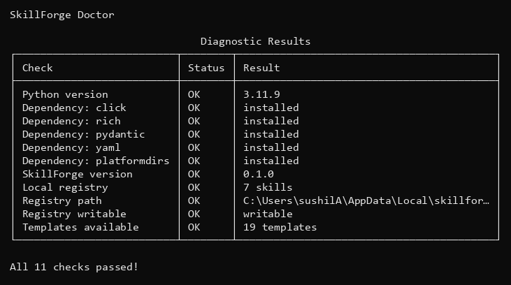
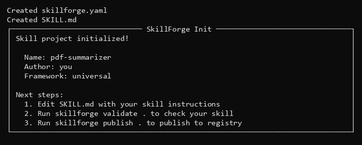
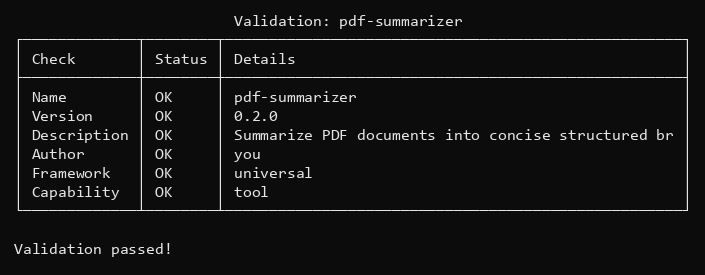
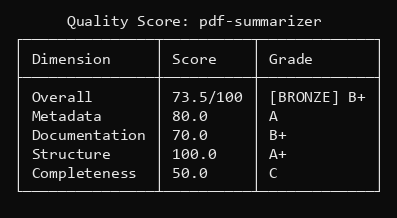
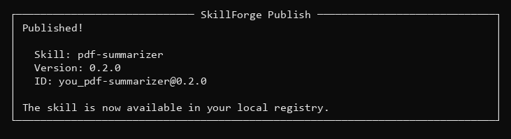
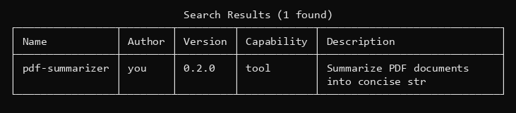
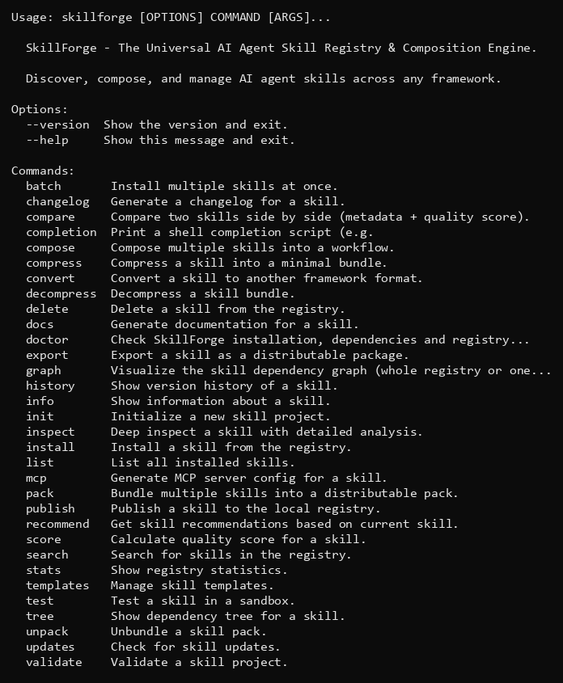
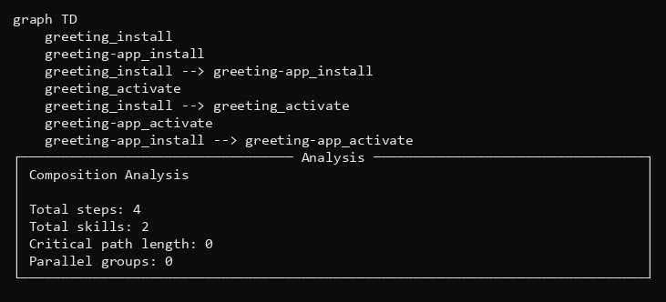
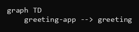
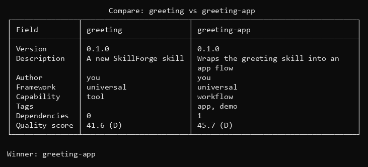

# SkillForge

**The Universal AI Agent Skill Registry & Composition Engine**

[](https://github.com/reyansh14coder-ux/skillforge/actions)
[](https://www.python.org/downloads/)
[](LICENSE)
[](tests)
[](#built-in-templates)
[](#command-reference)
[](https://modelcontextprotocol.io)

SkillForge gives your AI agent skills an **npm-style workflow**: create, validate, score, version, publish, discover, compose and export them — all from one local-first CLI that works with **Claude Code, Codex, Cursor, Cline and OpenCode**.

- **Local-first** — your registry lives on your machine, no account or network needed
- **5 runtime dependencies** — click, rich, pyyaml, pydantic, platformdirs
- **CI-tested** — 73 tests on Python 3.10 / 3.11 / 3.12 on every push

---

## Contents

- [Install](#install)
- [60-second quickstart](#60-second-quickstart)
- [Your first skill](#your-first-skill)
- [Recipes](#recipes)
- [Command reference](#command-reference)
- [Built-in templates](#built-in-templates)
- [Skill format](#skill-format)
- [Distribution: export, convert, pack, MCP](#distribution-export-convert-pack-mcp)
- [Composition, graphs and comparison](#composition-graphs-and-comparison)
- [Shell completion](#shell-completion)
- [Python API](#python-api)
- [Development](#development)
- [Roadmap](#roadmap)
- [Contributing](#contributing)
- [License](#license)

---

## Install

SkillForge is installed straight from GitHub (the name `skillforge` on PyPI is a
different package):

```bash
pip install git+https://github.com/reyansh14coder-ux/skillforge.git
```

Or from a source checkout:

```bash
git clone https://github.com/reyansh14coder-ux/skillforge.git
cd skillforge
pip install -e .
```

Check the installation:

```bash
skillforge doctor
```

```
                              Diagnostic Results
┌──────────────────────────┬────────┬─────────────────────────────────────────┐
│ Check                    │ Status │ Result                                  │
├──────────────────────────┼────────┼─────────────────────────────────────────┤
│ Python version           │ OK     │ 3.11.9                                  │
│ Dependency: click        │ OK     │ installed                               │
│ Dependency: rich         │ OK     │ installed                               │
│ Dependency: pydantic     │ OK     │ installed                               │
│ Dependency: yaml         │ OK     │ installed                               │
│ Dependency: platformdirs │ OK     │ installed                               │
│ SkillForge version       │ OK     │ 0.1.0                                   │
│ Local registry           │ OK     │ 7 skills                                │
│ Registry path            │ OK     │ C:\Users\you\AppData\Local\skillfo… │
│ Registry writable        │ OK     │ writable                                │
│ Templates available      │ OK     │ 19 templates                            │
└──────────────────────────┴────────┴─────────────────────────────────────────┘

All 11 checks passed!
```



Requirements: Python 3.10+, Windows / macOS / Linux.

---

## 60-second quickstart

```bash
skillforge init my-skill --name my-skill --author you   # scaffold a skill
skillforge validate my-skill                            # check it
skillforge score my-skill                               # grade it (A+…F)
skillforge publish my-skill                             # add to local registry
skillforge search my                                    # find it again
```

Every command that reads data also works in scripts — add `--json` to
`list`, `search`, `info`, `stats`, `score`, `validate`, `doctor`, `graph` or
`compare`. Commands exit **non-zero** on failure, so they are CI-friendly.

---

## Your first skill

A full round trip with real output. We create a skill, grade it, improve it,
publish it and find it again.

### 1. Scaffold

```bash
skillforge init . --name pdf-summarizer --author you
```

```
Created ...\skillforge.yaml
Created ...\SKILL.md
┌────────────────────────────── SkillForge Init ──────────────────────────────┐
│ Skill project initialized!                                                  │
│                                                                             │
│   Name: pdf-summarizer                                                      │
│   Author: you                                                               │
│   Framework: universal                                                      │
│                                                                             │
│ Next steps:                                                                 │
│   1. Edit SKILL.md with your skill instructions                             │
│   2. Run skillforge validate . to check your skill                          │
│   3. Run skillforge publish . to publish to registry                        │
└─────────────────────────────────────────────────────────────────────────────┘
```



### 2. Check it

```bash
skillforge validate .
```

```
             Validation: pdf-summarizer
┌─────────────┬────────┬────────────────────────────────────┐
│ Check       │ Status │ Details                            │
├─────────────┼────────┼────────────────────────────────────┤
│ Name        │ OK     │ pdf-summarizer                     │
│ Version     │ OK     │ 0.1.0                              │
│ Description │ OK     │ A new SkillForge skill             │
│ Author      │ OK     │ you                                │
│ Framework   │ OK     │ universal                          │
│ Capability  │ OK     │ tool                               │
│ Warning     │ WARN   │ No tags provided                   │
│ Warning     │ WARN   │ Version is 0.1.0 (default)         │
└─────────────┴────────┴────────────────────────────────────┘

Validation passed with 2 warnings
```

Warnings are fine for a draft — `skillforge validate . --strict` turns them
into a non-zero exit for CI.

### 3. Grade it

```bash
skillforge score .
```

```
    Quality Score: pdf-summarizer
┌───────────────┬──────────┬─────────┐
│ Dimension     │ Score    │ Grade   │
├───────────────┼──────────┼─────────┤
│ Overall       │ 56.2/100 │ [NEW] C │
│ Metadata      │ 65.0     │ B       │
│ Documentation │ 30.0     │ F       │
│ Structure     │ 100.0    │ A+      │
│ Completeness  │ 43.8     │ D       │
└───────────────┴──────────┴─────────┘

Suggestions:
  → Add tags for better discoverability
  → Add examples for better documentation
```

### 4. Follow the suggestions

Add tags and a real description to `skillforge.yaml`:

```yaml
metadata:
  name: pdf-summarizer
  version: 0.2.0
  description: "Summarize PDF documents into concise structured briefs"
  author: you
  framework: universal
  capability: tool
  tags: [pdf, summarize, documents]
```

And fill in `SKILL.md`:

````markdown
## Instructions

Step 1: Read the target PDF and extract its text content.
Step 2: Break the document into sections and summarize each one.
Step 3: Merge the section summaries into one brief with the key facts.

## Examples

    pdf-summarizer report.pdf --length short
````

Re-check and re-grade:

```bash
skillforge validate .   # → Validation passed!
skillforge score .
```

```
      Quality Score: pdf-summarizer
┌───────────────┬──────────┬─────────────┐
│ Dimension     │ Score    │ Grade       │
├───────────────┼──────────┼─────────────┤
│ Overall       │ 73.5/100 │ [BRONZE] B+ │
│ Metadata      │ 80.0     │ A           │
│ Documentation │ 70.0     │ B+          │
│ Structure     │ 100.0    │ A+          │
│ Completeness  │ 50.0     │ C           │
└───────────────┴──────────┴─────────────┘
```





**56.2 (C) → 73.5 (B+)** — the scorer tells you exactly what to fix.

### 5. Publish and find it

```bash
skillforge publish .
```

```
┌──────────────────────────── SkillForge Publish ─────────────────────────────┐
│ Published!                                                                  │
│                                                                             │
│   Skill: pdf-summarizer                                                     │
│   Version: 0.2.0                                                            │
│   ID: you_pdf-summarizer@0.2.0                                              │
│                                                                             │
│ The skill is now available in your local registry.                          │
└─────────────────────────────────────────────────────────────────────────────┘
```



```bash
skillforge search pdf
```

```
                           Search Results (1 found)
┌────────────────┬────────┬─────────┬────────────┬────────────────────────────┐
│ Name           │ Author │ Version │ Capability │ Description                │
├────────────────┼────────┼─────────┼────────────┼────────────────────────────┤
│ pdf-summarizer │ you    │ 0.2.0   │ tool       │ Summarize PDF documents    │
│                │        │         │            │ into concise str           │
└────────────────┴────────┴─────────┴────────────┴────────────────────────────┘
```



That is the whole lifecycle: **init → validate → score → improve → publish → search**.

---

## Recipes

| You want to… | Command |
|---|---|
| Start a skill from a template | `skillforge init . --name my-skill --template doc-writer` |
| List the templates | `skillforge templates list` |
| Validate (draft mode) | `skillforge validate .` |
| Validate for CI (fails on warnings) | `skillforge validate . --strict` |
| Grade a skill | `skillforge score .` |
| Grade it in a pipeline | `skillforge score . --json` |
| Run a skill in a sandbox | `skillforge test .` |
| Publish to the local registry | `skillforge publish .` |
| Find skills | `skillforge search pdf --tags documents` |
| Inspect a registry skill | `skillforge info pdf-summarizer` |
| Show registry stats | `skillforge stats` |
| Export a distributable package | `skillforge export . -o ./dist` |
| Convert to another framework | `skillforge convert pdf-summarizer -t opencode` |
| Compose a workflow | `skillforge compose greeting greeting-app --format mermaid` |
| Visualize dependencies | `skillforge graph greeting-app` |
| Compare two skills | `skillforge compare greeting greeting-app` |
| Generate docs / changelog | `skillforge docs .` / `skillforge changelog .` |
| Generate an MCP server config | `skillforge mcp pdf-summarizer -o server.json` |
| Health-check your install | `skillforge doctor` |

---

## Command reference

All 32 commands. Each group is collapsible — click to expand.



<details>
<summary><b>Start, check and document a project</b> (9 commands)</summary>

| Command | What it does |
|---|---|
| `init [PATH]` | Scaffold a new skill project (`-n` name, `-a` author, `-f` framework, `-t` template) |
| `validate [PATH]` | Validate a skill project (`--strict`, `--json`; exits non-zero on failure) |
| `score [PATH]` | Quality score across 4 dimensions (`--json`) |
| `test [PATH]` | Test a skill in a sandbox (`-t` timeout, `-c` custom command) |
| `docs [PATH]` | Generate documentation for a skill (`-o` output file) |
| `changelog [PATH]` | Generate a changelog for a skill |
| `inspect [PATH]` | Deep inspection with detailed analysis |
| `recommend [PATH]` | Recommend related skills based on the current one |
| `doctor` | Check installation, dependencies and registry health (`--json`) |

</details>

<details>
<summary><b>Browse and manage the registry</b> (9 commands)</summary>

| Command | What it does |
|---|---|
| `list` | List all installed skills (`--json`) |
| `search [QUERY]` | Search skills (`-t` tags, `-c` capability, `-f` framework, `-l` limit, `--json`) |
| `info [NAME]` | Show information about a skill (`-v` version, `--json`) |
| `stats` | Registry statistics (`--json`) |
| `install NAME` | Install a skill from the registry (`-v` version) |
| `batch NAMES…` | Install multiple skills at once |
| `delete NAME` | Delete a skill (`-v` version, `--all`) |
| `history NAME` | Version history of a skill |
| `updates` | Check for skill updates (`-a` to show all) |

</details>

<details>
<summary><b>Compose, visualize and compare</b> (4 commands)</summary>

| Command | What it does |
|---|---|
| `compose SKILLS…` | Compose skills into a workflow (`-n` name, `-t` auto/chain/parallel, `-f` yaml/json/mermaid) |
| `graph [NAME]` | Dependency graph of the registry or one skill (`-f` mermaid/tree/json, `--json`) |
| `tree NAME` | Dependency tree for one skill |
| `compare A B` | Side-by-side metadata + quality score (`--json`) |

</details>

<details>
<summary><b>Distribute and convert</b> (8 commands)</summary>

| Command | What it does |
|---|---|
| `publish PATH` | Publish a skill to the local registry |
| `export PATH` | Export a distributable package (`-o` output dir) |
| `convert NAME` | Convert to another framework (`-t` claude/cursor/cline/opencode) |
| `pack NAMES…` | Bundle multiple skills into a pack |
| `unpack` | Unbundle a skill pack |
| `compress PATH` | Compress a skill into a minimal bundle (`-o` output file) |
| `decompress` | Decompress a skill bundle |
| `mcp NAME` | Generate MCP server config (`-o` output file) |

</details>

<details>
<summary><b>Tooling</b> (2 commands)</summary>

| Command | What it does |
|---|---|
| `templates` | Manage templates — `list`, `inspect NAME`, `use NAME [-d DIR]` |
| `completion` | Print a shell completion script (bash / zsh / fish / powershell) |

</details>

`skillforge --help` and `skillforge <command> --help` work everywhere.

---

## Built-in templates

19 production-ready starting points — `skillforge templates list`.

| Template | Purpose |
|---|---|
| `api-designer` | RESTful API design and documentation |
| `api-mocker` | Generate mock API servers for testing |
| `ci-pipeline` | Generate CI/CD pipeline configurations |
| `cli-builder` | Generate CLI tools with proper structure |
| `code-review` | Automated code review with security and style checks |
| `data-pipeline` | Build ETL and data processing pipelines |
| `database-optimizer` | Database query optimization and indexing |
| `doc-writer` | Generate comprehensive documentation |
| `docker-builder` | Generate optimized Docker configurations |
| `graphql-schema` | Generate GraphQL schemas from requirements |
| `microservice-scaffold` | Scaffold microservice architecture |
| `migration-assistant` | Code migration and upgrade assistance |
| `performance-profiler` | Profile and optimize code performance |
| `refactor-assistant` | Code refactoring with safety checks |
| `regex-builder` | Build and test regular expressions |
| `security-audit` | Security audit for code and dependencies |
| `state-machine` | Generate finite state machines from specs |
| `test-generator` | Generate comprehensive test suites |
| `webhook-manager` | Manage and process webhook integrations |

Two ways to use one:

```bash
skillforge init . --name my-skill --template doc-writer
skillforge templates use doc-writer -d ./my-skill
```

---

## Skill format

A skill is a directory with two files. `skillforge.yaml` is the source of truth
for metadata; `SKILL.md` holds the human-readable instructions.

```
my-skill/
├── skillforge.yaml   # metadata, config, version, tags, dependencies
└── SKILL.md          # instructions, usage, examples
```

**skillforge.yaml** (abridged from a real skill):

```yaml
metadata:
  name: pdf-summarizer
  version: 0.2.0
  description: "Summarize PDF documents into concise structured briefs"
  author: you
  framework: universal        # universal | claude-code | codex | cursor | cline | opencode
  capability: tool            # tool | workflow | agent | hook | rule | prompt | dataset
  tags: [pdf, summarize, documents]
  dependencies: []            # e.g. {name: greeting, version_constraint: ">=0.1.0"}

config:
  env_vars: {}
  requires_permissions: []
  max_execution_time_seconds: 300
  sandbox_required: false

content: {}                   # usually filled from SKILL.md
```

**SKILL.md** uses `#` for the name and `##` sections for content:

````markdown
# pdf-summarizer

One-line description.

**Author:** you
**Version:** 0.2.0

## Instructions

What the agent should do, step by step.

## Examples

    pdf-summarizer report.pdf --length short
````

Loading order when several config files exist:
`skillforge.yaml` → `skillforge.yml` → `skillforge.json` → `skill.md` → `SKILL.md`.
Instructions written in `SKILL.md` are always merged in, so `score`, `docs`
and `recommend` see them even when a YAML config exists.
`skillforge.json` works too if you prefer JSON over YAML.

---

## Distribution: export, convert, pack, MCP

```bash
skillforge export . -o ./dist                     # distributable package
skillforge convert pdf-summarizer -t opencode      # → AGENTS.md
skillforge convert pdf-summarizer -t claude        # → Claude Code format
skillforge convert pdf-summarizer -t cursor        # → Cursor rules
skillforge convert pdf-summarizer -t cline         # → Cline format
skillforge pack greeting greeting-app              # bundle several skills
skillforge mcp pdf-summarizer -o server.json       # MCP server config
```

- **4 export formats** — Claude Code, Cursor, Cline, OpenCode
- **Versioned** — `history`, `updates`, semantic versions with `>=`, `^`, `~` constraints
- **Composable packs** — ship a whole skill set as one artifact

---

## Composition, graphs and comparison

Chain skills into a workflow and export it as YAML, JSON or a Mermaid diagram:

```bash
skillforge compose greeting greeting-app --format mermaid
```

```
graph TD
    greeting_install
    greeting-app_install
    greeting_install --> greeting-app_install
    greeting_activate
    greeting_install --> greeting_activate
    greeting-app_activate
    greeting-app_install --> greeting-app_activate
```



(plus an analysis panel: total steps, skills, critical path, parallel groups)

Dependency graph of one skill:

```bash
skillforge graph greeting-app
```

```
graph TD
    greeting-app --> greeting
```



Dependency tree:

```bash
skillforge tree greeting-app
```

```
greeting-app v0.1.0
└── greeting >=0.1.0
```

Compare two skills — metadata *and* quality score, with a winner:

```bash
skillforge compare greeting greeting-app
```

```
                       Compare: greeting vs greeting-app
┌───────────────┬────────────────────────┬────────────────────────────────────┐
│ Field         │ greeting               │ greeting-app                       │
├───────────────┼────────────────────────┼────────────────────────────────────┤
│ Version       │ 0.1.0                  │ 0.1.0                              │
│ Description   │ A new SkillForge skill │ Wraps the greeting skill into an   │
│               │                        │ app flow                           │
│ Author        │ you                    │ you                                │
│ Framework     │ universal              │ universal                          │
│ Capability    │ tool                   │ workflow                           │
│ Tags          │                        │ app, demo                          │
│ Dependencies  │ 0                      │ 1                                  │
│ Quality score │ 41.6 (D)               │ 45.7 (D)                           │
└───────────────┴────────────────────────┴────────────────────────────────────┘

Winner: greeting-app
```



Scripting example:

```bash
skillforge list --json
```

```json
[
  {
    "name": "demo-skill",
    "author": "test-user",
    "version": "0.1.0",
    "description": "A new SkillForge skill",
    "versions": ["0.1.0"]
  }
]
```

---

## Shell completion

```bash
# bash
echo 'eval "$(skillforge completion bash)"' >> ~/.bashrc

# zsh
echo 'eval "$(skillforge completion zsh)"' >> ~/.zshrc

# fish
skillforge completion fish > ~/.config/fish/completions/skillforge.fish

# powershell
skillforge completion powershell | Out-String | Invoke-Expression
```

---

## Python API

The whole model layer is importable — no CLI required:

```python
from skillforge.core import Skill, SkillMetadata, SkillVersion

meta = SkillMetadata(
    name="pdf-summarizer",
    description="Summarize PDF documents into concise structured briefs",
    author="you",
    version=SkillVersion.parse("0.2.0"),
    tags=["pdf", "summarize"],
)
skill = Skill(metadata=meta, content={"instructions": "Summarize the PDF."})
print(skill.metadata.name, "->", skill.metadata.version)

v2 = SkillVersion.parse("2.1.0")
print("2.1.0 satisfies >=1.0.0:", v2.satisfies(">=1.0.0"))
```

```
pdf-summarizer -> 0.2.0
2.1.0 satisfies >=1.0.0: True
```

Other entry points:

```python
from skillforge.core import SkillLoader, DependencyResolver
from skillforge.registry import SkillRegistry
from skillforge.quality import SkillScorer
```

- **DependencyResolver** — resolves `>=`, `^`, `~` constraints, detects circular dependencies
- **SkillScorer** — the same 4-dimension scoring the CLI uses
- **SkillRegistry** — list/search/get skills programmatically

---

## Development

```bash
git clone https://github.com/reyansh14coder-ux/skillforge.git
cd skillforge
python -m venv venv
venv\Scripts\activate          # Windows — use: source venv/bin/activate
pip install -e ".[dev]"

pytest tests/ -q               # 73 passed
ruff check skillforge/ tests/  # all checks passed
```

Layout:

```
skillforge/
├── skillforge/
│   ├── cli/main.py            # all 32 commands (click + rich)
│   ├── core/                  # models, loader, dependency resolver
│   ├── registry/              # local skill registry
│   ├── composition/           # workflow engine (chain/parallel/DAG)
│   ├── quality/               # scoring, validation, analytics
│   ├── sandbox/               # isolated skill testing
│   ├── templates/             # 19 built-in templates
│   └── utils/
├── tests/
│   ├── test_skillforge.py     # 49 unit tests
│   └── test_cli.py            # 24 CLI tests
├── docs/ARCHITECTURE.md
├── examples/
└── .github/workflows/ci.yml   # lint + tests on 3.10 / 3.11 / 3.12
```

CI runs `ruff check skillforge/ tests/` and `pytest tests/ -v` on every push
for Python 3.10, 3.11 and 3.12, then builds the package with `python -m build`.

---

## Roadmap

### Phase 1: Core (complete)

- [x] Skill models, validation and semantic versioning
- [x] Dependency resolution (with cycle detection)
- [x] Local registry with search, history and updates
- [x] 32-command CLI with `--json` and shell completion
- [x] Sandbox testing
- [x] Composition engine (chain / parallel / DAG)
- [x] Quality scoring (4 dimensions)
- [x] 19 built-in templates
- [x] Test suite (73 tests) and CI pipeline

### Phase 2: Remote registry

- [ ] Remote registry server
- [ ] User authentication
- [ ] Skill ratings and reviews
- [ ] Download statistics

### Phase 3: Advanced features

- [ ] Automated security scanning
- [ ] IDE extensions (VS Code, JetBrains)
- [ ] Team/organization registries
- [ ] Skill usage analytics

### Phase 4: Ecosystem

- [ ] Skill marketplace
- [ ] Paid skills support
- [ ] Public API for programmatic access

---

## Contributing

Contributions are welcome — see [CONTRIBUTING.md](CONTRIBUTING.md).

1. Fork the repository and create a feature branch
2. Make your change with tests (`pytest tests/ -q`)
3. Keep the linter green (`ruff check skillforge/ tests/`)
4. Open a pull request against
   [reyansh14coder-ux/skillforge](https://github.com/reyansh14coder-ux/skillforge)

Bug reports and feature requests go to
[GitHub Issues](https://github.com/reyansh14coder-ux/skillforge/issues).

---

## License

MIT — see [LICENSE](LICENSE).

Built for the AI agent community, inspired by npm, pip and cargo.
